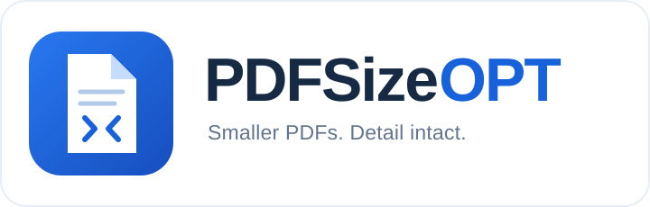

<p align="center">
  
</p>

<p align="center"><strong>A local Windows desktop app for high-fidelity PDF compression.</strong></p>

<p align="center">
  <a href="LICENSE"></a>
  
  
</p>

<p align="center">
  <a href="#installation">Install</a> ·
  <a href="src/pdfsizeopt_app/engine.py">Core source</a> ·
  <a href="docs/ENGINE.md">Engine guide</a> ·
  <a href="#usage">Usage</a> ·
  <a href="#license">License</a> ·
  <a href="#acknowledgments">Acknowledgments</a>
</p>

PDFSizeOPT reduces PDF size by simplifying eligible vector structures, deduplicating resources, and applying lossless object optimization. The default profile preserves image resolution, keeps vector content scalable, and checks the rendered result before saving the output.

Processing runs entirely on your computer. There are no accounts, uploads, cloud APIs, or subscriptions. Internet access is needed only to install dependencies.

> **Platform:** Windows x64. **Interface:** Simplified Chinese, with an English control guide below.

## Features

- **Quality-first defaults:** no downsampling or lossy photo re-encoding unless explicitly enabled.
- **Vector-aware optimization:** inline eligible simple Form XObjects, retain transformations and clipping, and deduplicate resources.
- **Adaptive photo quality:** optional native-resolution JPEG encoding raises quality when fine detail misses the error limits, and keeps the original image if no smaller result passes.
- **Per-page verification:** compare original and output at 2,000 and 8,000 pixels along the longer edge by default.
- **Automatic fallback:** reject candidates with pixel differences, try a conservative rewrite, or save an unchanged copy.
- **Batch processing:** add multiple PDFs or a folder, monitor each result, and cancel a running batch.
- **Flexible output:** custom destination, unchanged filenames by default, optional suffixes, and configurable collision handling.
- **Local reports:** sizes, settings, hashes, timing, and quality checks are recorded in `logs/`.

## Core compression engine

**Start with [`src/pdfsizeopt_app/engine.py`](src/pdfsizeopt_app/engine.py).** This is the executable compression and verification pipeline, not just the desktop interface.

| Implementation | What it does |
|---|---|
| [`compact_vectors()`](src/pdfsizeopt_app/engine.py#L126) | Inline eligible simple vector forms, preserve transforms and clipping, and compress rewritten streams |
| [`rewrite()`](src/pdfsizeopt_app/engine.py#L259) | Clone the document and deduplicate PDF objects using pypdf |
| [`polish()`](src/pdfsizeopt_app/engine.py#L275) | Invoke the optional upstream `pts/pdfsizeopt` optimizer |
| [`render_verify()`](src/pdfsizeopt_app/engine.py#L317) | Compare original and candidate pages using PDFium |
| [`compress_pdf()`](src/pdfsizeopt_app/engine.py#L381) | Select a validated result, handle fallback, and save it atomically |

The built-in vector transformations, verification, and output management are implemented in this repository. Deep optimization is delegated to the original [pts/pdfsizeopt](https://github.com/pts/pdfsizeopt) project, whose source remains upstream. See the [engine walkthrough](docs/ENGINE.md) for the full call flow, a Python example, and links to both implementations.

## Measured example

A vector-heavy, single-page reference figure was processed with the default settings.

| Measurement | Result |
|---|---:|
| Original | 23,114,956 bytes, approximately 23.11 MB |
| Compressed | 2,337,355 bytes, approximately 2.34 MB |
| Reduction | **89.888%** |
| Changed pixels at a 2,000-pixel long edge | **0** |
| Changed pixels at an 8,000-pixel long edge | **0** |
| Lossy photo re-encoding | Disabled |

This is one measured result, not a guaranteed compression ratio. Already-optimized PDFs may shrink little or not at all. The reference PDF is not distributed here. See [validation notes](VALIDATION.md).

### Test your own documents

The [corpus test runner](benchmarks/run_corpus.py) runs strict-lossless and adaptive-photo profiles against your local PDFs and records sizes, timing, and quality checks. Inputs and measurements remain local. See the [benchmark protocol](docs/BENCHMARKS.md) for instructions and limitations.

## Requirements

- Windows x64 and a writable project folder.
- **64-bit Python 3.12** with `pip` and Tcl/Tk. Python 3.13 is accepted by the installer; the recorded regression tests use Python 3.12.
- Internet access during setup for PyPI and the optional upstream optimizer.

Use the full Python installer with Tcl/Tk, not the minimal embeddable ZIP. See the official [Python Windows installation guide](https://docs.python.org/3.12/using/windows.html). For compatibility with the older optional optimizer, install the app in an ASCII-only path without spaces, such as `C:\PDFSizeOPT`. Chinese characters and spaces in input/output PDF paths have been tested successfully.

## Installation

### 1. Get the source

```powershell
git clone https://github.com/Rtwotwo/PDFSizeOPT.git
cd PDFSizeOPT
```

Alternatively, use **Code → Download ZIP** on GitHub and extract the entire archive. Do not run the app from inside the ZIP.

This repository includes the complete application source, tests, and setup scripts. Third-party runtimes, downloaded binaries, logs, personal settings, and machine-specific shortcuts are generated locally rather than committed.

### 2. Install dependencies

Install Python first, then double-click **`setup.cmd`**. It detects Python 3.12 or 3.13 and runs the installer. The equivalent PowerShell command is:

```powershell
py -3.12 setup_windows.py
```

Setup checks Python and Tcl/Tk, creates `.venv/`, installs the versions in `requirements.txt`, and downloads the pinned Windows optimizer from [pts/pdfsizeopt](https://github.com/pts/pdfsizeopt). Optimizer downloads are checked against the SHA-256 values in `dependencies.json` before being installed into `bin/`.

Setup does not install Python itself or change system security settings. Administrator privileges are unnecessary when the project folder is writable. Keep the folder in place after creating `.venv`; recreate the environment if you move the project.

To install without the optional external optimizer:

```powershell
py -3.12 setup_windows.py --skip-optimizer
```

The built-in vector and resource optimization remains available. To add the optimizer later:

```powershell
py -3.12 setup_windows.py --optimizer-only
```

### 3. Launch

Double-click **`start.cmd`**. The Chinese-named `启动PdfSizeOPT.cmd` launches the same app. For console diagnostics:

```powershell
.\.venv\Scripts\python.exe app.py
```

Optionally, create a shortcut from PowerShell if local script policy permits it:

```powershell
.\create_shortcut.ps1
```

This creates `PdfSizeOPT.lnk` inside the project folder. To also place a shortcut on your Windows desktop:

```powershell
.\create_shortcut.ps1 -Desktop
```

Shortcuts point to this project folder, so keep it in place or recreate them after moving it. `start.cmd` works without a shortcut. If you already have a prepared local package containing `runtime/` and `bin/`, the launcher uses that runtime first and no additional installation is needed.

## Usage

1. Click **添加 PDF** to choose one or more PDFs, or **添加文件夹** to add PDFs directly inside a folder. Subfolders are not scanned.
2. Choose the destination. By default, each result goes into a `压缩结果` folder beside its original file.
3. Leave the filename suffix empty to preserve the original name.
4. Keep the default settings for the fidelity-first workflow and click **开始压缩**.
5. Review size, reduction, status, and quality checks. Double-click a completed row to open its result, or select a failed row to read the error.

| Chinese control | English meaning |
|---|---|
| 添加 PDF / 添加文件夹 | Add PDFs / add a folder |
| 自定义输出目录 / 浏览 | Custom destination / browse |
| 文件名后缀 | Optional filename suffix |
| 自动编号，保留两份 | Add a number when an output name already exists |
| 跳过已存在文件 / 覆盖输出文件 | Skip existing outputs / replace existing outputs |
| 恢复高保真默认 | Restore fidelity-first defaults |
| 开始压缩 / 取消 | Start compression / cancel |
| 打开输出目录 | Open the output folder |

You can also pass paths at startup:

```powershell
.\.venv\Scripts\python.exe app.py "C:\Figures\figure.pdf" "C:\Figures\another.pdf"
```

Dragging PDFs onto the generated shortcut is supported; dragging into the app window is not implemented. **Ctrl+O** opens the file picker. **Delete** removes selected items from the queue, not from disk.

### Output behavior

```text
C:\Figures\figure.pdf
         ↓ default output
C:\Figures\压缩结果\figure.pdf
```

The default suffix is empty. If a destination filename already exists, the default policy creates `figure (2).pdf`, then `figure (3).pdf`. You may instead skip an existing output or explicitly replace it.

An output path identical to its source is rejected. Choose another directory or add a suffix. The final file is published only after processing and verification finish, so cancellation does not leave a partially written final PDF. Settings are saved to `settings.json` when a job starts.

## Settings

| Setting | Default | Purpose |
|---|---|---|
| Simple vector compaction | On | Inline eligible forms without rounding coordinates |
| Resource deduplication | On | Remove identical and unreferenced objects |
| Deep lossless optimization | On | Run the optional optimizer on a temporary candidate |
| Compression level | 9 | Deflate level for rewritten vector streams, from 1 to 9 |
| Per-page visual verification | On | Compare the original and candidate renderings |
| Verification long edge | 8,000 px | Also check at 2,000 px; higher values need more memory and time |
| Lossy photo re-encoding | **Off** | Encode eligible raw photo-like images as high-quality JPEG |
| JPEG starting quality | 96 | Optional photo encoding starts here, then raises quality up to 100 if needed |
| Filename suffix | Empty | Preserve the original name |
| Existing output | Auto-number | Preserve both files |

The optional optimizer is invoked with PNGOUT, JBIG2, font optimization, font unification, and font regeneration disabled. The application does not rasterize whole pages as a compression shortcut.

### Optional photo compression

The **可选照片压缩** tab enables a separate **lossy** mode. It retains image dimensions and uses JPEG 4:4:4 chroma sampling. Existing JPEG/JPX images, masked images, low-color graphics, and detected flat-background diagrams are skipped. This is a selective option, not a universal photograph detector.

The quality control is a **starting value**, never a target reached by lowering quality. For each eligible image, the encoder tries that value and then higher values up to 100. Each accepted JPEG must be smaller and meet all three native-resolution checks:

- RGB PSNR of at least **48 dB** over the entire image.
- At least **42 dB** at the 99th-percentile error level across 64 × 64 tiles.
- At least **40 dB** for the worst tile, including partial edge tiles.

If no smaller JPEG meets these limits, the original image is retained. These numerical gates limit error; they are not a guarantee of perceptual equivalence for every image. Even JPEG quality 100 is not necessarily lossless.

Vector/object optimization is validated first with **zero pixel differences**, separately from photographic changes. Any post-photo object optimization must also match the photo candidate exactly. The final photo output additionally requires page PSNR of at least 40 dB at both render scales. This prevents the photo tolerance from masking changes introduced by vector compaction. The interface reports **高质量有损** when any photo is re-encoded.

Keep photo encoding off when exact rendered agreement is the priority. Turning off visual verification skips rendered checks, but native-image quality checks remain active. The extra validation takes more time than a fixed JPEG quality setting.

## Quality checks and limitations

The app checks page geometry, annotation counts, and the presence of selected catalog features, then compares PDFium renderings at the configured scales. Default-mode candidates must have zero changed pixels at both scales. If the smallest result fails, another candidate or a conservative rewrite is tried. If no smaller acceptable result is available, an unchanged copy is saved with status **原样保留**.

These checks apply to the tested renderer and resolutions, not every PDF viewer, zoom level, or interactive feature. Encrypted documents and documents containing signature fields are rejected rather than rewritten. Large or many-page PDFs take longer because every page is checked twice.

## Troubleshooting

| Symptom | Resolution |
|---|---|
| Python is not found | Install full 64-bit Python with pip, Tcl/Tk, and the launcher; reopen the terminal and rerun setup. |
| Tcl/Tk or `init.tcl` is missing | Use a full Python installation with Tcl/Tk rather than the embedded ZIP. |
| Download or checksum failure | Check access to PyPI, GitHub, and raw.githubusercontent.com, then rerun setup. Do not substitute an unverified binary. |
| External optimizer cannot start | Turn off deep lossless optimization and use the built-in path. Consult upstream notes for legacy runtime compatibility. |
| App closes on startup | Run `.\.venv\Scripts\python.exe app.py` and inspect `logs/startup_error.log`. |
| Output has the same size | No smaller verified candidate was found; an unchanged copy is expected. |
| Verification is slow | Reduce verification resolution if appropriate, or retain the default for detailed checks. |
| Output equals source error | Choose another output folder or add a filename suffix. |

The normal Python/CMD workflow needs no unsigned custom launcher or security-policy changes. C# launcher source is included for developers with a suitable build and signing environment.

## Development

Run the automated tests:

```powershell
.\.venv\Scripts\python.exe -m unittest discover -s tests -v
```

Tests generate synthetic fixtures and cover defaults, Chinese paths, naming collisions, source protection, cancellation, atomic output, bookmarks and metadata, rendering differences and fallback, and optional photo compression. No private PDFs are needed.

```text
app.py                       GUI and worker entry point
src/pdfsizeopt_app/engine.py  Transformations, verification, atomic output
src/pdfsizeopt_app/gui.py     Tk desktop interface
src/pdfsizeopt_app/worker.py  Isolated batch worker
setup_windows.py             Project-local dependency installer
setup.cmd / start.cmd        Windows setup and startup
dependencies.json            Pinned optimizer downloads and checksums
requirements.txt             Pinned Python dependencies
create_shortcut.ps1           Shortcut creation
launcher.cs                  Optional C# launcher source
build_launcher.ps1           Optional launcher build script
build_icon.py / assets/       Reproducible application icon
docs/ENGINE.md               Core functions, call flow, and upstream source map
LICENSE                      MIT license for this project's original work
tests/                       Automated tests
licenses/                    Third-party notices
```

Regenerate the icon with `python build_icon.py`. Build the optional launcher with `build_launcher.ps1`. `.venv/`, `runtime/`, `bin/`, `.downloads/`, `logs/`, `settings.json`, and generated shortcuts are local artifacts ignored by Git.

## Contributing

Issues and focused pull requests are welcome. See the [contributing guide](CONTRIBUTING.md) for reproduction details, tests, and source-code orientation.

## License

This project's original application code, documentation, and logo are released under the **[MIT License](LICENSE)**, copyright 2026 Rtwotwo.

Third-party components keep their own licenses. In particular, the optional upstream `pts/pdfsizeopt` program remains under its [GPL-2.0 license](https://github.com/pts/pdfsizeopt/blob/master/LICENSE); the MIT license here does not relicense that program or its tool bundle. See [third-party notices](licenses/THIRD_PARTY.md) for the component list and upstream sources.

## Acknowledgments

Special thanks to **Peter Szabo and the contributors to the original [pts/pdfsizeopt](https://github.com/pts/pdfsizeopt)**. Its PDF optimization program and Windows tool bundle power this application's optional deep-optimization stage. PDFSizeOPT is an independent desktop application and is not an official release of that upstream project.

We also thank the maintainers and contributors of:

- [py-pdf/pypdf](https://github.com/py-pdf/pypdf) for PDF parsing, rewriting, and object deduplication.
- [pypdfium2-team/pypdfium2](https://github.com/pypdfium2-team/pypdfium2) and [chromium/pdfium](https://github.com/chromium/pdfium) for PDF rendering used in verification.
- [python-pillow/Pillow](https://github.com/python-pillow/Pillow) for image handling and optional JPEG encoding.
- [numpy/numpy](https://github.com/numpy/numpy) for pixel comparisons.
- [python/cpython](https://github.com/python/cpython) and [tcltk/tk](https://github.com/tcltk/tk) for the local runtime and desktop interface.

The README's presentation takes inspiration from [Stirling-PDF](https://github.com/Stirling-Tools/Stirling-PDF) and [shadcn/ui](https://github.com/shadcn-ui/ui). The PDFSizeOPT logo follows this project's existing document-and-inward-arrows icon and is provided as an editable [SVG](assets/logo.svg).
