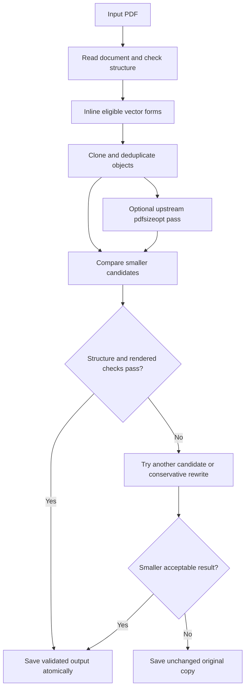

# The compression engine

The core implementation is **[`src/pdfsizeopt_app/engine.py`](../src/pdfsizeopt_app/engine.py)**. The GUI submits jobs through [`worker.py`](../src/pdfsizeopt_app/worker.py); each job calls `compress_pdf()`.

## Default call flow



This diagram describes the default profile. Lossy photo encoding is a separate option and is disabled by default.

## Function map

| Function | Source | Responsibility |
|---|---|---|
| `Settings` | [engine.py](../src/pdfsizeopt_app/engine.py#L45) | Defaults, compression controls, verification scales, and output policy |
| `compact_vectors()` | [engine.py](../src/pdfsizeopt_app/engine.py#L125) | Select suitable leaf forms, remap graphics-state names, preserve matrices and bounding-box clips, and Deflate the expanded stream |
| `photo_reencode()` | [engine.py](../src/pdfsizeopt_app/engine.py#L212) | Optional JPEG conversion of eligible raw photo-like images, without resizing |
| `rewrite()` | [engine.py](../src/pdfsizeopt_app/engine.py#L246) | Clone the catalog and pages and use pypdf's object deduplication |
| `polish()` | [engine.py](../src/pdfsizeopt_app/engine.py#L262) | Invoke the separately installed upstream optimizer |
| `structure_info()` | [engine.py](../src/pdfsizeopt_app/engine.py#L288) | Capture page geometry, annotation counts, and selected catalog features |
| `render_verify()` | [engine.py](../src/pdfsizeopt_app/engine.py#L299) | Compare PDFium-rendered pixels at two scales |
| `output_path()` | [engine.py](../src/pdfsizeopt_app/engine.py#L345) | Preserve names, handle collisions, and reject source/output identity |
| `compress_pdf()` | [engine.py](../src/pdfsizeopt_app/engine.py#L363) | Orchestrate candidates, fallback, source checks, reports, and atomic output |

### Vector compaction

The built-in pass targets repeated simple PDF Form XObjects. It excludes forms with unsupported resources or features such as transparency groups. An eligible invocation is replaced by a saved graphics state, the original transformation matrix, its bounding-box clip, its drawing operators, and a restored graphics state. Resource names are remapped to avoid collisions, and coordinates are not intentionally rounded.

This can remove substantial PDF-object overhead in vector-heavy exports while retaining scalable paths. It does not render a page to an image. Some equivalent-looking transformations can still change rasterized edge pixels, so the candidate must pass the rendered checks before being selected in the default mode.

### What comes from upstream

PDF parsing, writing, and object deduplication use **[pypdf](https://github.com/py-pdf/pypdf)**. Rendering uses **[pypdfium2/PDFium](https://github.com/pypdfium2-team/pypdfium2)**. The optional deep-optimization stage calls **[the original pts/pdfsizeopt project](https://github.com/pts/pdfsizeopt)** as a separate process.

The upstream optimizer's implementation can be read directly in [`lib/pdfsizeopt/main.py`](https://github.com/pts/pdfsizeopt/blob/bc6c3ec21eb73888797f6411c6c96dadfeb56f76/lib/pdfsizeopt/main.py), with supporting modules in its [pinned source tree](https://github.com/pts/pdfsizeopt/tree/bc6c3ec21eb73888797f6411c6c96dadfeb56f76/lib/pdfsizeopt). The installer fetches its [pinned program](https://github.com/pts/pdfsizeopt/blob/bc6c3ec21eb73888797f6411c6c96dadfeb56f76/pdfsizeopt.single) and [official Windows bundle](https://github.com/pts/pdfsizeopt/releases/tag/2023-04-18), verifies their checksums, and places them in the ignored `bin/` directory. That is why the downloaded executable is not part of this repository's source listing.

Turning off **Deep lossless optimization**, or setting `Settings(lossless_polish=False)`, skips this external stage. Built-in vector compaction, pypdf-based rewriting, and verification remain available. Their compression benefit depends on the input document.

## Use the core from Python

Run from the repository root with the installed environment:

```python
from pathlib import Path
import sys

sys.path.insert(0, str(Path("src").resolve()))
from pdfsizeopt_app.engine import Settings, compress_pdf

result = compress_pdf(
    r"C:\Figures\figure.pdf",
    directory=r"C:\Figures\compressed",
    settings=Settings(),
)
print(result["output"])
print(result["saved_percent"])
```

`Settings()` uses the same defaults as the GUI. Reports are written to `logs/`; the source file is checked for changes before the final result is published. See [the engine tests](../tests/test_engine.py) for synthetic examples of rendering differences, fallback, metadata preservation, and photo compression.

## Licensing and attribution

This repository's original implementation is under [MIT](../LICENSE). The external optimizer retains its [upstream GPL-2.0 license](https://github.com/pts/pdfsizeopt/blob/master/LICENSE). The program does not claim ownership of the upstream optimization algorithms. See [third-party notices](../licenses/THIRD_PARTY.md) for the remaining components.
